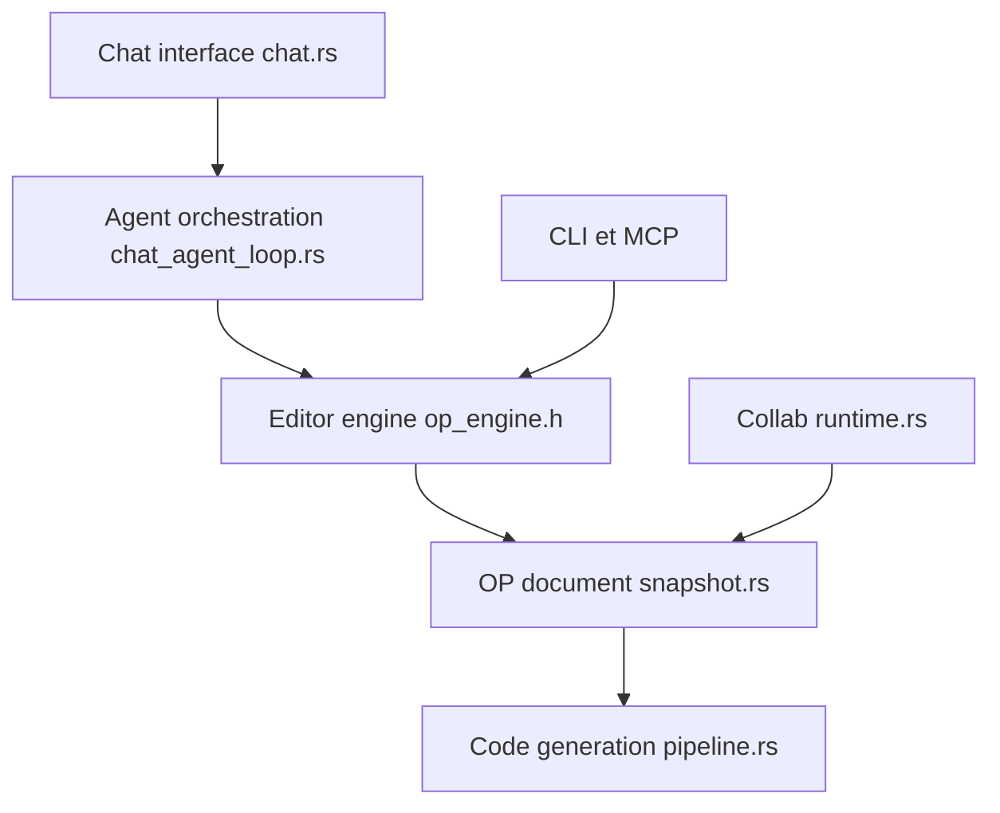

# ZSeven-W/openpencil

> Outil de design vectoriel natif en Rust, piloté par IA et MCP, qui exporte du code d'interface.

## Le problème
Passer d'une description d'interface à un design éditable puis à du code oblige à jongler entre plusieurs outils et formats.

## Ce que ça fait vraiment
Éditeur de canevas (fichiers `.op`, JSON) où des équipes d'agents génèrent des sections en parallèle depuis un prompt. Serveur MCP intégré, CLI `op`, export React+Tailwind, HTML, Vue, Svelte, Flutter, SwiftUI, Compose, import Figma `.fig`, collaboration pair à pair, intégration Git. Application de bureau en un seul binaire Rust ; version web via wasm.

## Comment c'est branché


## Essayer
```bash
brew tap zseven-w/openpencil
brew install --cask openpencil
brew install zseven-w/openpencil/op
```

## Coût et pièges
Il faut une clé de fournisseur de modèle (ou compte Claude Code/Codex). Le README contient des liens promotionnels de revendeurs d'API. Installateur Windows parfois signalé par les antivirus. Compilation depuis les sources : sous-modules git et Rust.

## Ce que ce n'est pas
Pas un remplaçant éprouvé de Figma : le projet est en forte évolution. La section « Assessments » du README est vide.

## Alternatives
Aucune alternative nommée dans le README.

## Pour toi
À surveiller : intéressant pour du prototypage d'interface piloté par agents, hors cœur data/MLOps ; attends la stabilisation.

