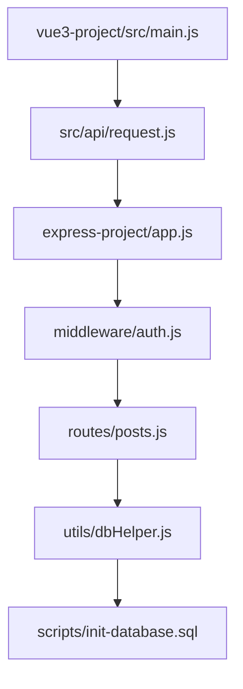

# ZTMYO/XiaoShiLiu

> Educational clone of Xiaohongshu in Vue 3 and Express: an image-and-text posting community.

## The problem
Provide a complete front-end and back-end example of an image-and-text social network, for learning.

## What it actually does
Vue 3 frontend (Pinia, Vite) calling the Express API through `request.js`; the JWT authentication middleware comes before the routes, which read MySQL through `dbHelper.js`. Posting, social interactions, administration, deployment via `docker-compose.yml`.

## How it is wired


## Trying it
```bash
npm install
npm run dev
npm run build
npm run preview
```

## Cost and gotchas
Node 18+, MySQL 5.7+ or MariaDB. Change `JWT_SECRET` and the database password before any use. Uses third-party image and IP geolocation APIs. AGPL-3.0 license.

## What it is not
Not affiliated with Xiaohongshu; announced as "for learning" use, with any exploitation risk left to the user. README in Chinese.

## Alternatives
No alternative named in the README.

## For you
Ignore: Chinese educational web app, off-topic for data/AI/MLOps.
