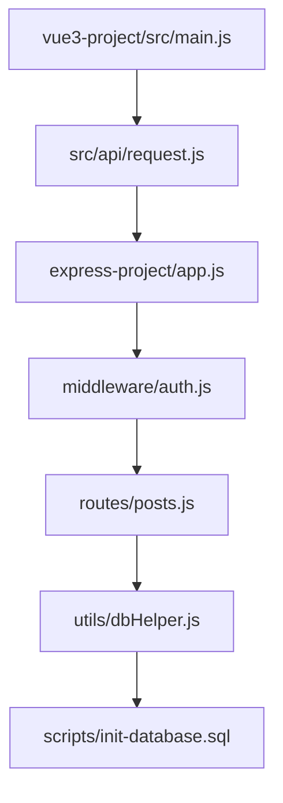

# ZTMYO/XiaoShiLiu

> Clone pédagogique de Xiaohongshu en Vue 3 et Express : communauté de publications image-texte.

## Le problème
Offrir un exemple complet front et back d'un réseau social image-texte pour apprendre.

## Ce que ça fait vraiment
Frontend Vue 3 (Pinia, Vite) qui appelle l'API Express via `request.js` ; le middleware d'authentification JWT précède les routes, qui lisent MySQL via `dbHelper.js`. Publication, interactions sociales, administration, déploiement `docker-compose.yml`.

## Comment c'est branché


## Essayer
```bash
npm install
npm run dev
npm run build
npm run preview
```

## Coût et pièges
Node 18+, MySQL 5.7+ ou MariaDB. Changer `JWT_SECRET` et le mot de passe de base avant tout usage. Utilise des API tierces d'images et de géolocalisation IP. Licence AGPL-3.0.

## Ce que ce n'est pas
Pas affilié à Xiaohongshu ; usage « apprentissage » annoncé, risque d'exploitation à la charge de l'utilisateur. README en chinois.

## Alternatives
Aucune alternative nommée dans le README.

## Pour toi
Ignorer : appli web chinoise d'apprentissage, hors sujet data/IA/MLOps.

