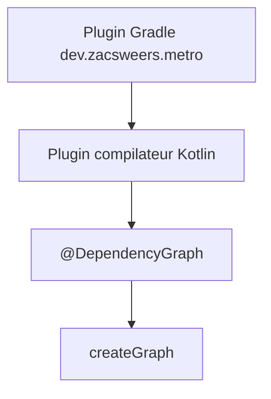

# ZacSweers/metro

> Compile-time dependency injection framework for Kotlin Multiplatform, via a compiler plugin.

## The problem
Dependency graph errors show up at runtime, and both Dagger and kotlin-inject require KAPT or KSP.

## What it actually does
A Kotlin compiler plugin generates the injection code and validates the graph at compile time. It borrows ideas from Dagger, Anvil and kotlin-inject (`@ContributesTo`, `@ContributesBinding` aggregation) and targets JVM, JS, Wasm and native. A gradual migration from Dagger, kotlin-inject or Guice is supported.

## How it is wired
Simplified diagram based on the fiche, no diagram provided.


## Trying it
```kotlin
plugins {
  id("dev.zacsweers.metro") version "<version>"
}
```
```kotlin
val graph = createGraph<AppGraph>()
val repository = graph.repository
```

## Cost and gotchas
Free. Requires a Kotlin and Gradle project (not listed in the prerequisites); compatibility depends on the Kotlin version, see the Compatibility page.

## What it is not
Not an application framework: dependency injection only. The README claims it is fast, with no figures provided.

## Alternatives
- Dagger: established ecosystem.
- Anvil: contribution aggregation.
- kotlin-inject: the original Kotlin API.

## For you
Ignore: Kotlin dependency injection for Android or multiplatform, of no interest to a data, AI or MLOps profile.
