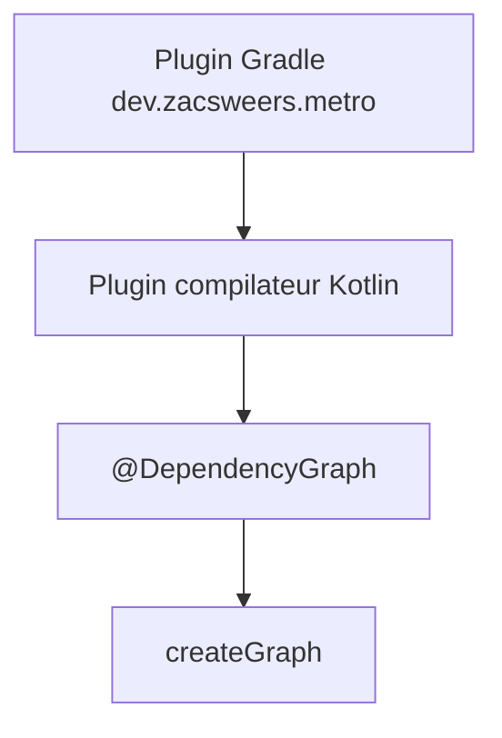

# ZacSweers/metro

> Framework d'injection de dépendances à la compilation pour Kotlin Multiplatform, via plugin de compilateur.

## Le problème
Les erreurs de graphe de dépendances apparaissent à l'exécution, et Dagger comme kotlin-inject imposent KAPT ou KSP.

## Ce que ça fait vraiment
Un plugin du compilateur Kotlin génère le code d'injection et valide le graphe à la compilation. Il reprend des idées de Dagger, Anvil et kotlin-inject (agrégation `@ContributesTo`, `@ContributesBinding`) et cible JVM, JS, Wasm et natif. Une migration progressive depuis Dagger, kotlin-inject ou Guice est prévue.

## Comment c'est branché
Schéma simplifié d'après la fiche, sans diagramme fourni.


## Essayer
```kotlin
plugins {
  id("dev.zacsweers.metro") version "<version>"
}
```
```kotlin
val graph = createGraph<AppGraph>()
val repository = graph.repository
```

## Coût et pièges
Gratuit. Exige un projet Kotlin et Gradle (non listés dans les prérequis) ; la compatibilité dépend de la version de Kotlin, voir la page Compatibility.

## Ce que ce n'est pas
Pas un framework d'application : uniquement de l'injection de dépendances. Le README se dit rapide, sans chiffres fournis.

## Alternatives
- Dagger : écosystème établi.
- Anvil : agrégation de contributions.
- kotlin-inject : API Kotlin d'origine.

## Pour toi
Ignorer : de l'injection de dépendances Kotlin pour Android ou multiplateforme, sans intérêt pour un profil data, IA ou MLOps.

