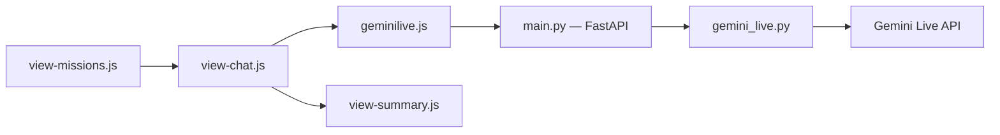

# ZackAkil/immersive-language-learning-with-live-api

> Demo voice role-play application for learning a language with Gemini Live.

## The problem
Practicing spoken language requires an available partner who plays realistic scenes.

## What it actually does
The browser sends audio over WebSocket to a FastAPI server, which relays it to the Gemini Live API. The learner picks a mission (buying a bus ticket), a language and a mode (Teacher or Immersive). They get a score at the end of the session. Options: BigQuery for metrics, reCAPTCHA, Redis for rate limiting.

## How it is wired


## Trying it
```bash
git clone <repository-url>
cd immersive-language-learning-with-live-api
./scripts/install.sh
cp .env.example .env
./scripts/dev.sh
```

## Cost and gotchas
Google Cloud project with Vertex AI and ADC credentials. The README estimates about 1.7 cents per minute of conversation (price as of January 19, 2026). One-click Cloud Run deployment.

## What it is not
A demo, not a learning product: no progress tracking. Last push in April 2026.

## Alternatives
No alternative named in the README.

## For you
Watch: a good reference example for a real-time audio application on Gemini Live, of no direct interest if you do not work on Google Cloud.
