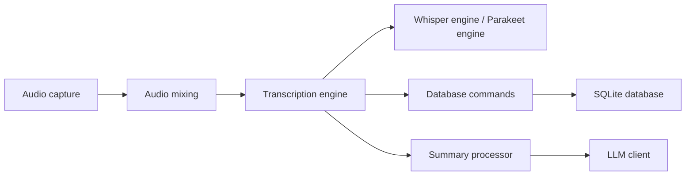

# Zackriya-Solutions/meetily

> Local meeting assistant: records, transcribes and summarizes while keeping the data on your machine.

## The problem
Cloud transcription tools send your meetings to a third party, which raises privacy and compliance issues.

## What it actually does
Tauri application (Rust backend, Next.js interface). The described architecture shows the flow of audio capture, mixing, recording, import, Whisper and Parakeet engines, a model manager, then summary generation by an LLM client (Ollama, Anthropic, OpenAI-compatible API) and SQLite storage. The README (identical to meeting-minutes') advertises Metal/CoreML on macOS and Vulkan on Windows; CUDA only when building from source.

## How it is wired


## Trying it
```bash
git clone https://github.com/Zackriya-Solutions/meeting-minutes
cd meeting-minutes/frontend
pnpm install --frozen-lockfile
./build-gpu.sh
```

## Cost and gotchas
Free community edition, paid PRO (different code, promo code LAUNCH20 mentioned). Windows requires an AVX2 CPU. A summary via a cloud provider sends the text off your machine.

## What it is not
Not a 100% offline tool as soon as a remote LLM is chosen. This repository seems to be the same project as meeting-minutes (same README, same creation date): probably a rename.

## Alternatives
No alternative cited in the README.

## For you
To adopt, like meeting-minutes: local Whisper transcription and Ollama summary for sensitive meetings; keep only one of the two repositories in your tracking.
