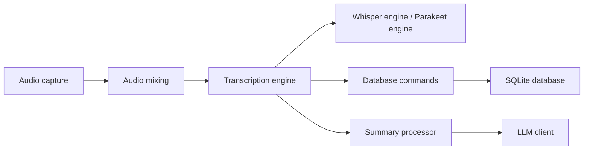

# Zackriya-Solutions/meetily

> Assistant de réunion local : enregistre, transcrit et résume en gardant les données sur ta machine.

## Le problème
Les outils de transcription cloud envoient tes réunions chez un tiers ; ce qui pose des problèmes de confidentialité et de conformité.

## Ce que ça fait vraiment
Application Tauri (backend Rust, interface Next.js). L'architecture décrite montre le flux capture audio, mixage, enregistrement, import, moteurs Whisper et Parakeet, gestionnaire de modèles, puis génération de résumé par un client LLM (Ollama, Anthropic, API compatible OpenAI) et stockage SQLite. Le README (identique à celui de meeting-minutes) annonce Metal/CoreML sur macOS et Vulkan sur Windows ; CUDA seulement en compilation source.

## Comment c'est branché


## Essayer
```bash
git clone https://github.com/Zackriya-Solutions/meeting-minutes
cd meeting-minutes/frontend
pnpm install --frozen-lockfile
./build-gpu.sh
```

## Coût et pièges
Édition communautaire gratuite, PRO payant (code différent, code promo LAUNCH20 mentionné). Windows exige un CPU AVX2. Un résumé via fournisseur cloud envoie le texte hors de ta machine.

## Ce que ce n'est pas
Pas un outil 100 % hors ligne dès qu'un LLM distant est choisi. Ce dépôt semble être le même projet que meeting-minutes (même README, même date de création) : probablement un renommage.

## Alternatives
Aucune alternative citée dans le README.

## Pour toi
À adopter, comme meeting-minutes : transcription locale Whisper et résumé Ollama pour des réunions sensibles ; ne garder qu'un des deux dépôts dans ton suivi.

