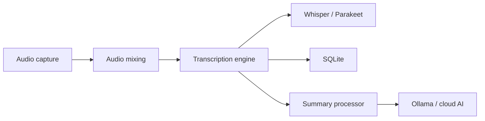

# Zackriya-Solutions/meeting-minutes

> Local meeting assistant: records, transcribes and summarizes while keeping the data on your machine.

## The problem
Cloud transcription tools send your meetings to a third party, which raises privacy and compliance problems.

## What it actually does
Tauri application (Rust backend, Next.js interface) that captures microphone and system audio with mixing, transcribes locally with Whisper or Parakeet, then summarizes via Ollama (local) or Claude, Groq, OpenRouter and an OpenAI-compatible endpoint. Audio file import in beta. Metal/CoreML acceleration on macOS, Vulkan on Windows; CUDA only when compiling from source. Data in local SQLite.

## How it is wired


## Trying it
```bash
git clone https://github.com/Zackriya-Solutions/meeting-minutes
cd meeting-minutes/frontend
pnpm install --frozen-lockfile
./build-gpu.sh
```
(Windows and macOS installation: installer from the Releases.)

## Cost and gotchas
Community edition is free; the PRO offering (different code) is paid. Windows requires an AVX2 CPU; Linux is compiled by hand. If you choose a cloud summary, the text goes to the provider.

## What it is not
Not entirely offline if you enable a remote LLM. Speaker diarization is announced for PRO only.

## Alternatives
No alternative is cited in the README (reuses code from Whisper.cpp, Screenpipe and transcribe-rs).

## For you
Adopt: to transcribe your meetings locally with Whisper and Ollama; the data stays on your machine as long as you avoid cloud summaries. Warning: the Zackriya-Solutions/meetily repository has an identical README.
