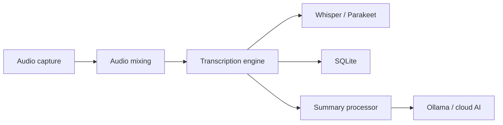

# Zackriya-Solutions/meeting-minutes

> Assistant de réunion local : enregistre, transcrit et résume en gardant les données sur ta machine.

## Le problème
Les outils de transcription cloud envoient tes réunions chez un tiers ; ce qui pose des problèmes de confidentialité et de conformité.

## Ce que ça fait vraiment
Application Tauri (backend Rust, interface Next.js) qui capture micro et audio système avec mixage, transcrit en local avec Whisper ou Parakeet, puis résume via Ollama (local) ou Claude, Groq, OpenRouter et endpoint compatible OpenAI. Import de fichiers audio en bêta. Accélération Metal/CoreML sur macOS, Vulkan sur Windows ; CUDA seulement en compilation source. Données en SQLite local.

## Comment c'est branché


## Essayer
```bash
git clone https://github.com/Zackriya-Solutions/meeting-minutes
cd meeting-minutes/frontend
pnpm install --frozen-lockfile
./build-gpu.sh
```
(Installation Windows et macOS : installateur des Releases.)

## Coût et pièges
Édition communautaire gratuite ; l'offre PRO (code différent) est payante. Windows exige un CPU AVX2 ; Linux se compile à la main. Si tu choisis un résumé cloud, le texte part vers le fournisseur.

## Ce que ce n'est pas
Pas totalement hors ligne si tu actives un LLM distant. La diarisation des locuteurs est annoncée pour PRO seulement.

## Alternatives
Aucune alternative citée dans le README (reprend du code de Whisper.cpp, Screenpipe et transcribe-rs).

## Pour toi
À adopter pour transcrire tes réunions en local avec Whisper et Ollama ; les données restent sur ta machine tant que tu évites les résumés cloud. Attention : le dépôt Zackriya-Solutions/meetily a un README identique.

