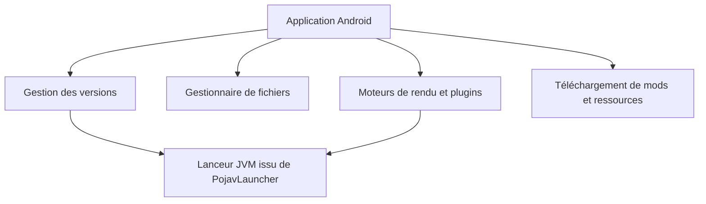

# ZalithLauncher/ZalithLauncher

> Minecraft Java launcher for Android, a community overhaul of PojavLauncher, aimed at mobile players.

## The problem
Running Minecraft Java on an Android phone requires a suitable launcher, and PojavLauncher's interface is considered not very accessible.

## What it actually does
- Builds on PojavLauncher with a redesigned interface and light and dark themes.
- Built-in file manager to work around Android permission restrictions.
- Several renderers, extensible through plugins, and customizable game folders.
- Download of mods, modpacks, resource packs, saves and shaders from within the app.

## How it is wired
Simplified diagram based on the sheet, no diagram provided.


## Trying it
```bash
# Aucune commande documentée dans le README.
```

## Cost and gotchas
Free. Archived repository: no more fixes. The README warns about a fake `.cn` site: only download from the official project.

## What it is not
Not a data or AI tool. Not Mojang's official project: it is a community remake, GPL-3.0.

## Alternatives
- PojavLauncher: the original project it derives from, cited in the README.

## For you
Ignore: an archived mobile game launcher has no use in data, AI or MLOps work.
