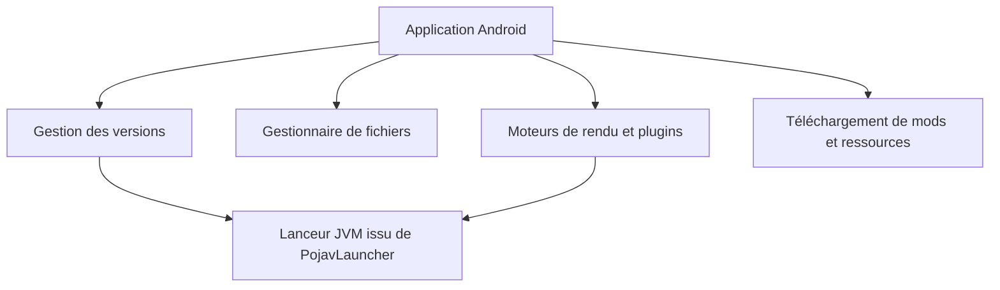

# ZalithLauncher/ZalithLauncher

> Lanceur Minecraft Java pour Android, refonte communautaire de PojavLauncher, destiné aux joueurs mobiles.

## Le problème
Faire tourner Minecraft Java sur un téléphone Android demande un lanceur adapté, et l'interface de PojavLauncher est jugée peu accessible.

## Ce que ça fait vraiment
- Reprend PojavLauncher avec une interface refaite et des thèmes clair et sombre.
- Gestionnaire de fichiers intégré pour contourner les restrictions de permissions Android.
- Plusieurs moteurs de rendu, extensibles par plugins, et dossiers de jeu personnalisables.
- Téléchargement de mods, modpacks, packs de ressources, sauvegardes et shaders depuis l'application.

## Comment c'est branché
Schéma simplifié d'après la fiche, sans diagramme fourni.


## Essayer
```bash
# Aucune commande documentée dans le README.
```

## Coût et pièges
Gratuit. Dépôt archivé : plus de correctifs. Le README alerte sur un faux site en `.cn` : ne télécharger qu'depuis le projet officiel.

## Ce que ce n'est pas
Pas un outil data ou IA. Pas le projet officiel de Mojang : c'est un remake communautaire, GPL-3.0.

## Alternatives
- PojavLauncher : le projet d'origine dont il dérive, cité dans le README.

## Pour toi
À ignorer : un lanceur de jeu mobile archivé n'a aucun usage dans un travail data, IA ou MLOps.

