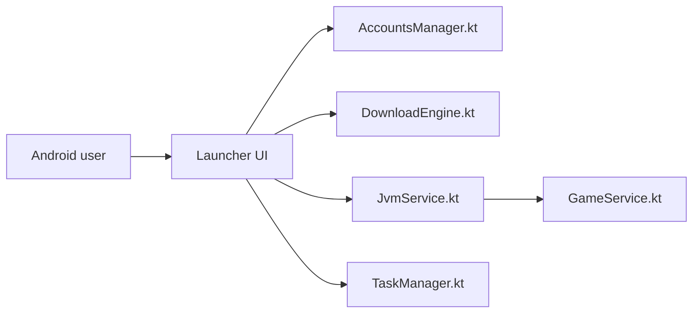

# ZalithLauncher/ZalithLauncher2

> Android launcher for Minecraft Java Edition, in Jetpack Compose, for mobile players.

## The problem
Playing Minecraft Java on Android requires a launcher that handles the JVM, accounts, downloads and touch input.

## What it actually does
A launcher based on PojavLauncher: Material Design 3 interface, account management, download engine, JVM service and foreground service, file manager, control layouts, OpenAL audio, Terracotta VPN. Translations go through Weblate.

## How it is wired


## Trying it
```bash
git clone git@github.com:ZalithLauncher/ZalithLauncher2.git
# Use Android Studio to open the project and build it
```

## Cost and gotchas
Free. Build: Android Studio, API 26 minimum, JDK 11. The README warns about a fake official site using the name.

## What it is not
Unrelated to the first ZalithLauncher. GPLv3 §7 clauses require renaming any modified version.

## Alternatives
No alternative named (PojavLauncher is the core used).

## For you
Ignore: a mobile game launcher has no use for a data/AI/MLOps profile.
