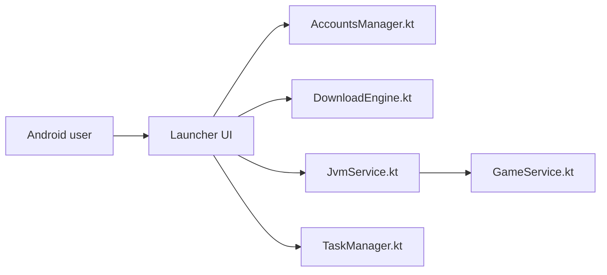

# ZalithLauncher/ZalithLauncher2

> Lanceur Android de Minecraft Java Edition, en Jetpack Compose, pour joueurs sur mobile.

## Le problème
Jouer à Minecraft Java sur Android exige un lanceur gérant JVM, comptes, téléchargements et saisie tactile.

## Ce que ça fait vraiment
Lanceur basé sur PojavLauncher : interface Material Design 3, gestion de comptes, moteur de téléchargement, service JVM et service de premier plan, gestionnaire de fichiers, dispositions de contrôles, audio OpenAL, VPN Terracotta. Les traductions passent par Weblate.

## Comment c'est branché


## Essayer
```bash
git clone git@github.com:ZalithLauncher/ZalithLauncher2.git
# Use Android Studio to open the project and build it
```

## Coût et pièges
Gratuit. Build : Android Studio, API 26 minimum, JDK 11. Le README alerte sur un faux site officiel diffusant le nom.

## Ce que ce n'est pas
Sans rapport avec le premier ZalithLauncher. Des clauses GPLv3 §7 imposent de renommer toute version modifiée.

## Alternatives
Aucune alternative nommée (PojavLauncher est le cœur utilisé).

## Pour toi
Ignorer : un lanceur de jeu mobile n'a aucun usage pour un profil data/IA/MLOps.

