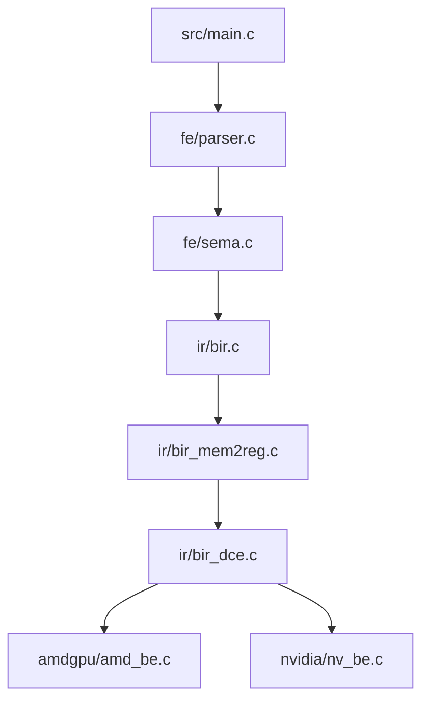

# Zaneham/BarraCUDA

> C99 compiler that translates CUDA, HIP or Triton to AMD, NVIDIA, CPU or Tenstorrent targets, without LLVM.

## The problem
CUDA kernels only run on NVIDIA cards, and alternative compilers depend on LLVM.

## What it actually does
The `kath` binary reads CUDA C, HIP or Triton (also Fortran via LFortran, OCaml), lowers it to a homegrown IR (bir), applies passes such as mem2reg and dce, then generates AMD RDNA 2/3/4 code, NVIDIA PTX (and a native SASS backend), Tenstorrent Metalium or x86-64. The README states that all 67 files of ggml-cuda reach the IR.

## How it is wired


## Trying it
```bash
./kath --version
make
./kath run kernel.cu
./kath --amdgpu-bin kernel.cu -o kernel.hsaco
./kath doctor
```

## Cost and gotchas
Ready-made binaries for Linux, macOS, Windows; otherwise a C99 compiler is enough. Coverage level varies by backend (see the repository's Feature status).

## What it is not
Not a production-validated replacement for nvcc: a recent project (February 2026) by a single person.

## Alternatives
The README cites ROCm, nvcc and the Triton JIT as the original toolchains.

## For you
Watch: very relevant for running CUDA on AMD hardware, but still experimental.
