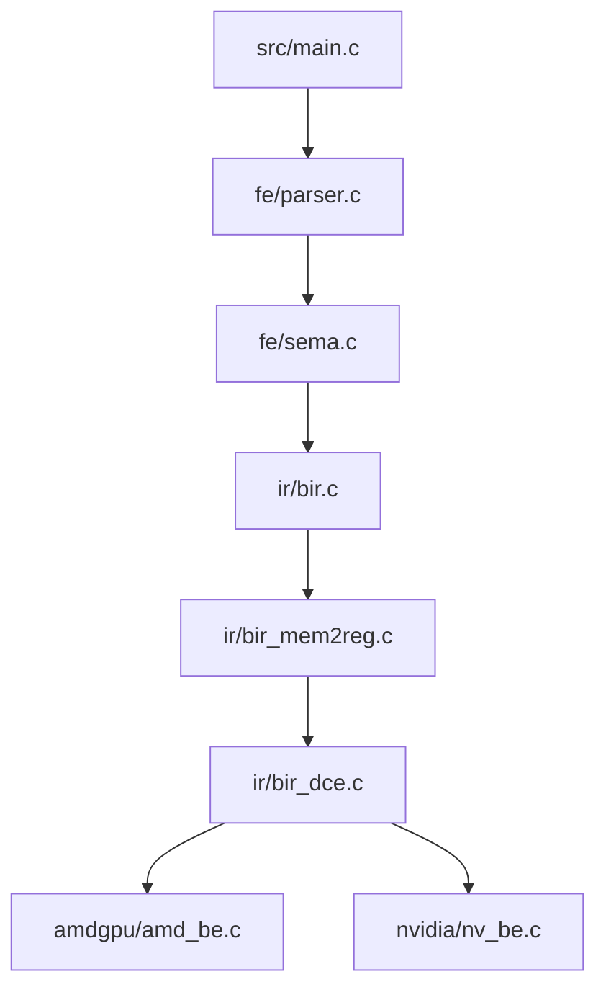

# Zaneham/BarraCUDA

> Compilateur C99 qui traduit du CUDA, HIP ou Triton vers GPU AMD, NVIDIA, CPU ou Tenstorrent, sans LLVM.

## Le problème
Les noyaux CUDA ne tournent que sur des cartes NVIDIA, et les compilateurs alternatifs dépendent de LLVM.

## Ce que ça fait vraiment
Le binaire `kath` lit du CUDA C, du HIP ou du Triton (aussi Fortran via LFortran, OCaml), le descend vers un IR maison (bir), applique des passes comme mem2reg et dce, puis génère du code AMD RDNA 2/3/4, du PTX NVIDIA (et un backend SASS natif), du Metalium Tenstorrent ou du x86-64. Le README annonce que les 67 fichiers de ggml-cuda atteignent l'IR.

## Comment c'est branché


## Essayer
```bash
./kath --version
make
./kath run kernel.cu
./kath --amdgpu-bin kernel.cu -o kernel.hsaco
./kath doctor
```

## Coût et pièges
Binaires prêts pour Linux, macOS, Windows ; sinon un compilateur C99 suffit. Le niveau de couverture varie par backend (voir Feature status du dépôt).

## Ce que ce n'est pas
Ce n'est pas un remplaçant de nvcc validé en production : projet récent (février 2026) d'une seule personne.

## Alternatives
Le README cite ROCm, nvcc et le JIT de Triton comme chaînes d'origine.

## Pour toi
À surveiller : très pertinent pour exécuter du CUDA sur du matériel AMD, mais encore expérimental.

