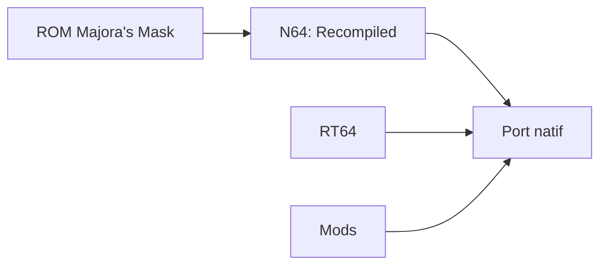

# Zelda64Recomp/Zelda64Recomp

> Native port of Majora's Mask obtained by static recompilation, for players who own the game.

## The problem
Play the N64 game on a modern PC without an emulator, with widescreen, gyroscope aiming and mods.

## What it actually does
The project statically translates the game's code via N64: Recompiled and renders with RT64. It loads assets from your US ROM and adds autosave, dual stick, gyroscope and mod support. The repository contains no game assets.

## How it is wired
Simplified diagram based on the sheet, no diagram provided.

## Trying it
No command documented in the README: download the published release, or read BUILDING.md to build it.

## Cost and gotchas
Free, but a US ROM is required and a GPU compatible with Direct3D 12, Vulkan 1.2 or Metal. GPL-3.0 license (copyleft).

## What it is not
Not an emulator: it accepts only a single ROM. Ocarina of Time is only planned.

## Alternatives
No alternative named in the README.

## For you
Ignore: retro game unrelated to data / AI / MLOps work.
