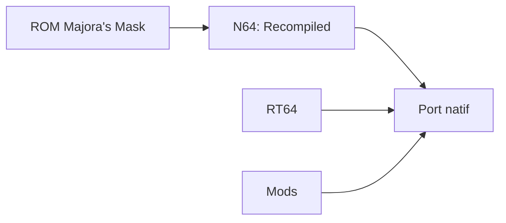

# Zelda64Recomp/Zelda64Recomp

> Portage natif de Majora's Mask obtenu par recompilation statique, pour joueurs possédant le jeu.

## Le problème
Jouer au jeu N64 sur PC moderne sans émulateur, avec widescreen, visée au gyroscope et mods.

## Ce que ça fait vraiment
Le projet traduit statiquement le code du jeu via N64: Recompiled et rend avec RT64. Il charge les ressources depuis ta ROM américaine et ajoute sauvegarde automatique, double stick, gyroscope et support de mods. Le dépôt ne contient aucune ressource du jeu.

## Comment c'est branché
Schéma simplifié d'après la fiche, sans diagramme fourni.

## Essayer
Aucune commande documentée dans le README : télécharger la version publiée, ou lire BUILDING.md pour compiler.

## Coût et pièges
Gratuit, mais ROM américaine requise et GPU compatible Direct3D 12, Vulkan 1.2 ou Metal. Licence GPL-3.0 (copyleft).

## Ce que ce n'est pas
Ce n'est pas un émulateur : il n'accepte qu'une seule ROM. L'Ocarina of Time est seulement prévu.

## Alternatives
Aucune alternative nommée dans le README.

## Pour toi
À ignorer : jeu rétro sans lien avec un travail data / IA / MLOps.

