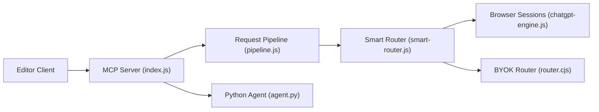

# Zen4-bit/Proxima

> Local gateway that exposes ChatGPT, Claude or Gemini browser sessions as an MCP server and an OpenAI API.

## The problem
API calls to frontier models cost money on every prompt; the author wants to use them from his coding tools through his free accounts.

## What it actually does
An Electron application with a Node MCP server (40 tools), an OpenAI-compatible REST API on `:3210` and a WebSocket. Two modes: web sessions (automation of logged-in accounts in browser views) or BYOK (OpenAI, Anthropic, Groq, Ollama, LM Studio..., keys kept in the OS vault). It includes a Python agent with SQLite memory, gated execution (Full Auto, Smart, Suggest) and a CLI.

## How it is wired


## Trying it
```bash
git clone https://github.com/Zen4-bit/Proxima.git
cd Proxima
npm install
npm start
```

## Cost and gotchas
Session mode is free but the README admits it may breach the providers' terms of use; for professional use, it recommends BYOK. Session mode sends your prompts to those providers. Node 18+, Python 3.10+ for the agent. License "present but not identified".

## What it is not
It is not legitimate "free" access to the APIs: it automates web accounts. No stability guarantee, since the web interfaces change.

## Alternatives
No alternative named in the README.

## For you
Ignore: the risk of account blocking and of breaching the terms of use, plus the unclear license, outweigh the savings; prefer official API keys.
