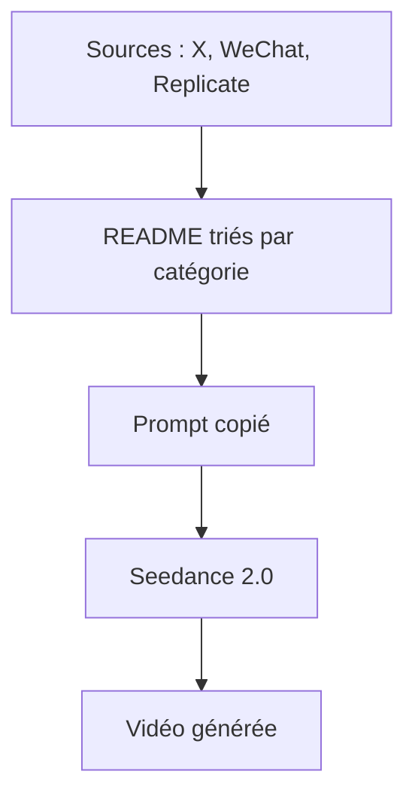

# ZeroLu/awesome-seedance

> Collection of Seedance 2.0 prompts for video generation, sorted by style, with example videos.

## The problem
Writing good video prompts by trial and error is slow; effective examples are scattered across X and WeChat.

## What it actually does
The list gathers sorted prompts: film styles, advertising, memes, UGC style, animation. Many are split by shots with timestamps, dialogue or framing cues. Each entry cites its source (X accounts, Replicate blog) and links to a result video. The README is translated into several languages.

## How it is wired
Simplified diagram based on the fiche, no diagram provided.



## Trying it
```bash
# Aucune commande documentée : copier un prompt du README dans Seedance 2.0.
```

## Cost and gotchas
The list is free, but generation goes through the Seedance service, for which the README gives neither price nor access. The prompt text is under MIT license; the videos and brands cited belong to their authors.

## What it is not
Not a tool or code: no script, no benchmark, no guarantee that a prompt is reproducible. Several video links may die, the README already flags one as 404.

## Alternatives
No alternative is named in the README.

## For you
Ignore: useful for a video creative, but with no technical value for a data / AI / MLOps profile.
