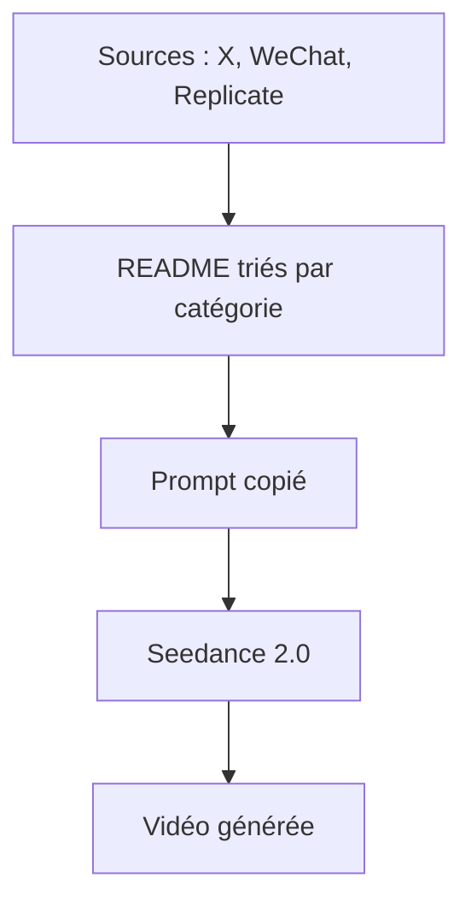

# ZeroLu/awesome-seedance

> Collection de prompts Seedance 2.0 pour génération vidéo, classés par style, avec vidéos d'exemple.

## Le problème
Écrire de bons prompts vidéo par essais est long ; les exemples efficaces sont dispersés sur X et WeChat.

## Ce que ça fait vraiment
La liste réunit des prompts classés : styles de films, publicité, mèmes, style UGC, animation. Beaucoup sont découpés par plans avec des horodatages, des indications de dialogue ou de cadrage. Chaque entrée cite sa source (comptes X, blog Replicate) et pointe vers une vidéo de résultat. Le README est traduit en plusieurs langues.

## Comment c'est branché
Schéma simplifié d'après la fiche, sans diagramme fourni.



## Essayer
```bash
# Aucune commande documentée : copier un prompt du README dans Seedance 2.0.
```

## Coût et pièges
La liste est gratuite, mais la génération passe par le service Seedance, dont le README ne donne ni prix ni accès. Le texte des prompts est sous licence MIT, les vidéos et marques citées appartiennent à leurs auteurs.

## Ce que ce n'est pas
Ce n'est pas un outil ni un code : aucun script, aucun benchmark, aucune garantie de reproductibilité d'un prompt. Plusieurs liens vidéo peuvent mourir, le README en signale un déjà en 404.

## Alternatives
Aucune alternative n'est nommée dans le README.

## Pour toi
À ignorer : utile pour un créatif vidéo, mais sans valeur technique pour un profil data / IA / MLOps.

