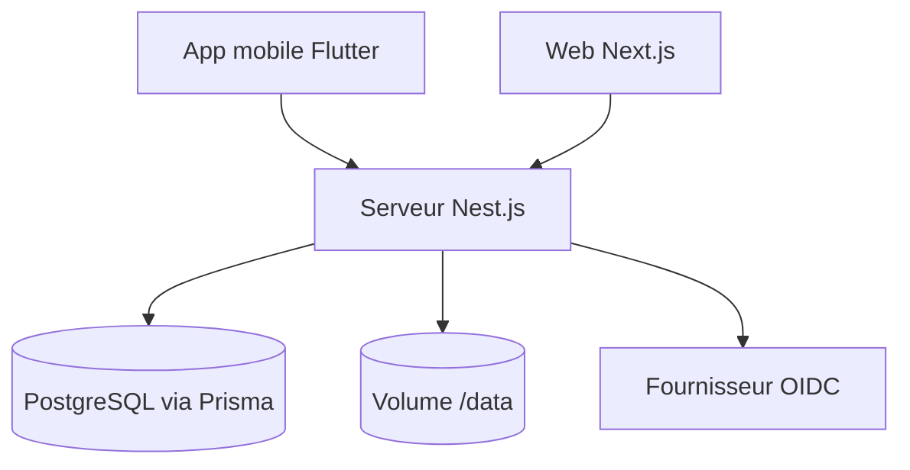

# ZhFahim/anchor

> Offline-first, self-hostable notes app with mobile and web clients.

## The problem
Mainstream notes apps store your data with a third party and work poorly without a network.

## What it actually does
Rich editor, tags, attachments, reminders, history, sharing between users, trash. Notes are local and synced when the network returns. Google Keep and Markdown import, zip export, OIDC authentication, admin panel.

## How it is wired
Simplified diagram based on the sheet, no diagram provided.


## Trying it
```bash
docker compose up -d
```
With a `docker-compose.yml` using `ghcr.io/zhfahim/anchor:latest` (port 3000), then open `http://localhost:3000`.

## Cost and gotchas
Free. An embedded Postgres database by default, or an external one via `PG_*`. Manual backup through zip export. The `next` image is unstable. iOS: TestFlight beta.

## What it is not
Not a hosted service. No end-to-end encryption announced. AGPL license: check it if you integrate it into a service.

## Alternatives
No alternative named in the README, apart from Google Keep as an import source.

## For you
Ignore for your line of work: a good self-hosted personal notes app, but outside the data / AI / MLOps watch.
