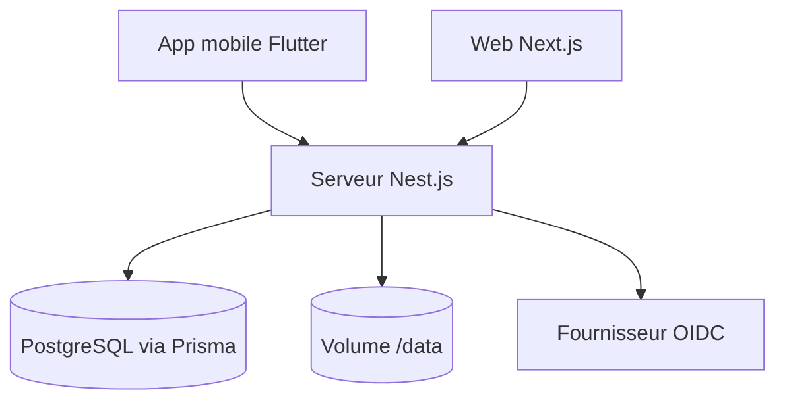

# ZhFahim/anchor

> Application de notes hors ligne d'abord, auto-hébergeable, avec clients mobile et web.

## Le problème
Les apps de notes grand public stockent tes données chez un tiers et marchent mal sans réseau.

## Ce que ça fait vraiment
Éditeur riche, étiquettes, pièces jointes, rappels, historique, partage entre utilisateurs, corbeille. Les notes sont locales et synchronisées au retour du réseau. Import Google Keep et Markdown, export zip, authentification OIDC, panneau d'administration.

## Comment c'est branché
Schéma simplifié d'après la fiche, sans diagramme fourni.


## Essayer
```bash
docker compose up -d
```
Avec un `docker-compose.yml` utilisant `ghcr.io/zhfahim/anchor:latest` (port 3000), puis ouvrir `http://localhost:3000`.

## Coût et pièges
Gratuit. Une base Postgres embarquée par défaut, ou externe via `PG_*`. Sauvegarde manuelle par export zip. L'image `next` est instable. iOS : bêta TestFlight.

## Ce que ce n'est pas
Pas un service hébergé. Pas de chiffrement de bout en bout annoncé. Licence AGPL : à vérifier si tu l'intègres à un service.

## Alternatives
Aucune alternative nommée dans le README, hormis Google Keep comme source d'import.

## Pour toi
À ignorer pour ton métier : bonne appli de notes perso auto-hébergée, mais hors de la veille data / IA / MLOps.

