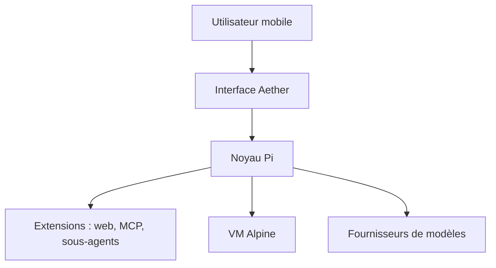

# Zhou-Shilin/Aether

> General-purpose AI agent for Android, iOS and macOS, built on the Pi framework and extensible.

## The problem
AI agents with tools live mostly in the terminal; few mobile apps make them usable by touch.

## What it actually does
Aether loads Pi extensions and gives them an API (settings cards, widgets, viewers). It embeds an Alpine virtual machine to run commands, with file access on Android. Official extensions add web search, an MCP gateway and sub-agents. Shizuku and Termux are optional on Android.

## How it is wired
Simplified diagram based on the sheet, no diagram provided.

## Trying it
No command documented in the README: the quick-start section points to an external page.

## Cost and gotchas
API key or local model requirements are not documented in this README. The Windows install link does not exist; macOS downloads go through the releases.

## What it is not
Not a local model in itself despite "Soar with local AI". No quick start in the README.

## Alternatives
No alternative cited in the README.

## For you
Worth watching: interesting for an agent on a phone, but the prerequisites are not documented and a single author carries it.
