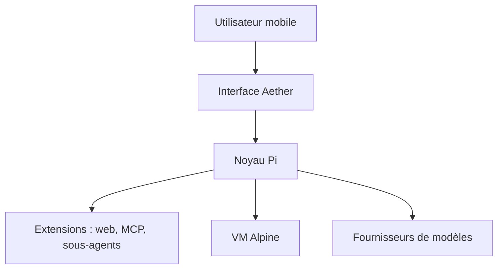

# Zhou-Shilin/Aether

> Agent IA généraliste pour Android, iOS et macOS, construit sur le framework Pi et extensible.

## Le problème
Les agents IA à outils vivent surtout en terminal ; peu d'applications mobiles les rendent utilisables au toucher.

## Ce que ça fait vraiment
Aether charge les extensions Pi et leur offre une API (cartes de réglages, widgets, visionneuses). Il embarque une machine virtuelle Alpine pour lancer des commandes, avec accès aux fichiers sous Android. Des extensions officielles ajoutent recherche web, passerelle MCP et sous-agents. Shizuku et Termux sont optionnels sous Android.

## Comment c'est branché
Schéma simplifié d'après la fiche, sans diagramme fourni.

## Essayer
Aucune commande documentée dans le README : la section de démarrage rapide renvoie à une page externe.

## Coût et pièges
Les besoins en clé d'API ou en modèle local ne sont pas documentés dans ce README. Le lien d'installation Windows n'existe pas ; les téléchargements macOS passent par les releases.

## Ce que ce n'est pas
Pas un modèle local en soi malgré « Soar with local AI ». Pas de démarrage rapide dans le README.

## Alternatives
Aucune alternative citée dans le README.

## Pour toi
À surveiller : intéressant pour un agent sur téléphone, mais les prérequis ne sont pas documentés et un seul auteur le porte.

