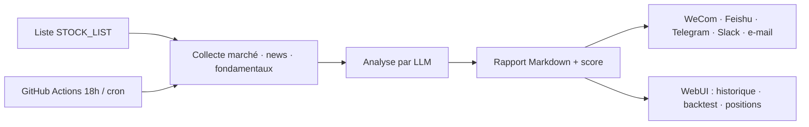

# ZhuLinsen/daily_stock_analysis

> Daily analysis of a stock portfolio by an LLM, delivered via messaging.

## The problem
Tracking a list of titles across multiple platforms requires manually aggregating course information, news, announcements, and key data each day.

## What it actually does
Aggregates market data (A-shares, Hong Kong, US, Japan, Korea, Taiwan, ETFs), news, and sentiment, and then uses an LLM to generate a "decision dashboard": conclusions, scores, trends, buy/sell points, risk alerts, and catalysts. Sends the results to WeCom, Feishu, Telegram, Discord, Slack, or email. Features a web interface with manual analysis, historical data, backtesting, positions, and a "Agent" mode with 15 integrated strategies (moving averages, Chanlun, waves, trend, event-based…).

## How it is wired


## Trying it
```bash
git clone https://github.com/ZhuLinsen/daily_stock_analysis.git && cd daily_stock_analysis
pip install -r requirements.txt
cp .env.example .env && vim .env
python main.py --stocks 600519,hk00700,AAPL,2330.TW
python main.py --webui
```

## Cost and gotchas
At least one LLM key and a notification channel are required. Free market data sources (AkShare, Baostock, YFinance) are subject to upstream rate limiting and interface changes: for scheduled data, the README recommends token-based sources (TickFlow, Tushare, Longbridge), which are paid. The README highlights promotional offers from API providers.

## What it is not
As the README states: intended for educational and research purposes only, not for investment advice. The author takes no responsibility for any losses. This is not a stock selection tool – that function is handled by the AlphaSift project. The documentation is almost entirely in Chinese.

## Alternatives
- AlphaSift: this project does not include a title selection feature.
- AlphaEvo: Backtesting and strategy evolution.

## For you
It should be viewed primarily as an architectural pattern ("collect data → LLM → scheduled deployment"), rather than as a financial tool.
