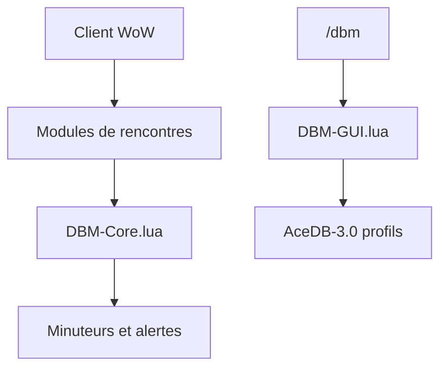

# Zidras/DBM-Warmane

> Deadly Boss Mods addon for World of Warcraft 3.3.5a, Warmane servers, backported from retail.

## The problem
WotLK raiders on Warmane lack precise boss timers and alerts.

## What it actually does
Encounter modules (raids, dungeons, world bosses, events) feed a DBM core that displays timers, alerts, range checks, arrows and a health bar. Voice packs and WeakAuras are optional.

## How it is wired


## Trying it
```bash
# Pas de commande shell : copier les dossiers DBM-* dans Interface/Addons.
# En jeu : /dbm   puis   /dbm help
```

## Cost and gotchas
Free. Installing erases old DBM profiles. No license declared.

## What it is not
Not an addon for the current retail client: targets WotLK 3.3.5a and Warmane.

## Alternatives
No alternative named in the README.

## For you
Ignore: a game addon unrelated to data, AI or MLOps.
