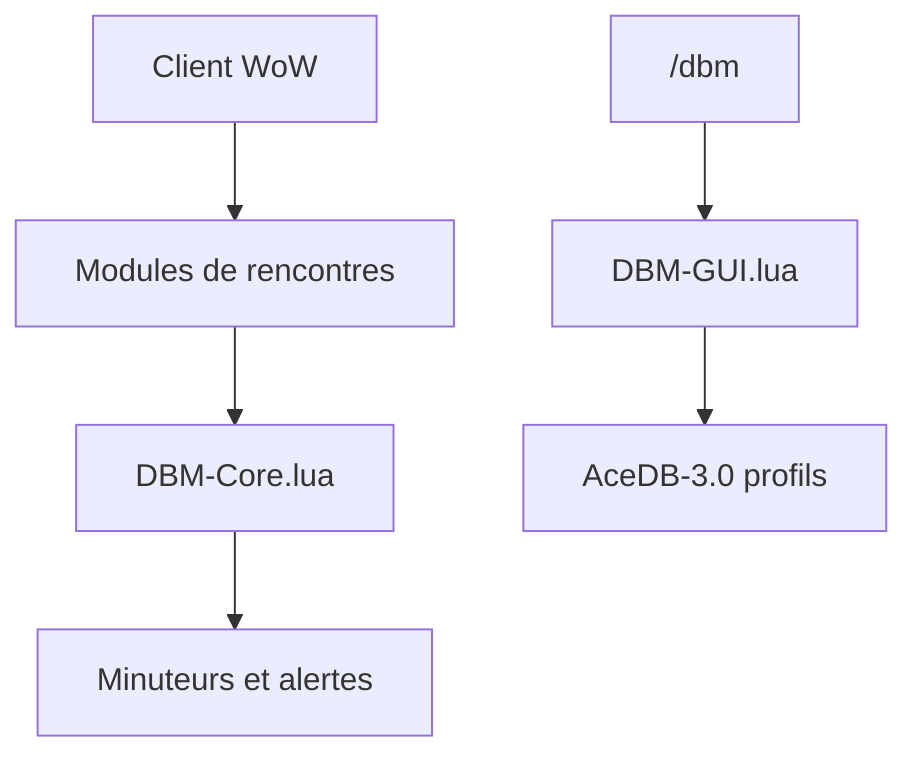

# Zidras/DBM-Warmane

> Addon Deadly Boss Mods pour World of Warcraft 3.3.5a, serveurs Warmane, rétroporté de retail.

## Le problème
Les joueurs de raids WotLK sur Warmane manquent de minuteurs et d'alertes de boss précis.

## Ce que ça fait vraiment
Des modules de rencontres (raids, donjons, boss de monde, événements) alimentent un noyau DBM qui affiche minuteurs, alertes, vérification de portée, flèches et barre de vie. Packs vocaux et WeakAuras en option.

## Comment c'est branché


## Essayer
```bash
# Pas de commande shell : copier les dossiers DBM-* dans Interface/Addons.
# En jeu : /dbm   puis   /dbm help
```

## Coût et pièges
Gratuit. L'installation efface les anciens profils DBM. Aucune licence déclarée.

## Ce que ce n'est pas
Pas un addon pour le client retail actuel : ciblé WotLK 3.3.5a et Warmane.

## Alternatives
Aucune alternative nommée dans le README.

## Pour toi
À ignorer : addon de jeu sans rapport avec data, IA ou MLOps.

