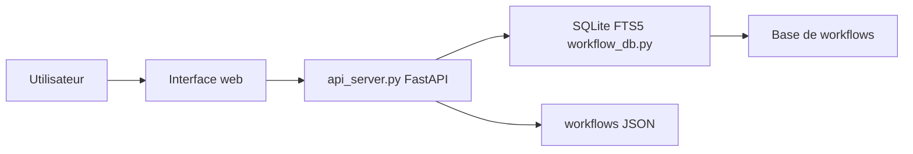

# Zie619/n8n-workflows

> Collection of thousands of exported n8n workflows, with a local or online search engine.

## The problem
Finding a ready-to-import n8n workflow template for a given use case (marketing, DevOps, sales…) means digging by hand.

## What it actually does
The repository gathers workflow JSON files (the README counts 4,343 workflows, 365 integrations, 15 categories: figures not verified here) and a FastAPI application with SQLite FTS5: full-text search, filters by category, complexity, trigger or service, export and statistics. A GitHub Pages site lets you browse without installing anything.

## How it is wired


## Trying it
```bash
git clone https://github.com/Zie619/n8n-workflows.git
cd n8n-workflows
pip install -r requirements.txt
python run.py
docker run -p 8000:8000 zie619/n8n-workflows:latest
```

## Cost and gotchas
Free; you then need an n8n instance and accounts for the services called. The README claims "production-ready" and "100% import success" (unverified claims); no per-workflow license.

## What it is not
It is not n8n itself. The architecture report describes a data repository without a server: the README, which is authoritative, describes a FastAPI application.

## Alternatives
No alternative named in the README.

## For you
Watch: a good source of automation ideas, to be reviewed before importing (credentials, external calls).
