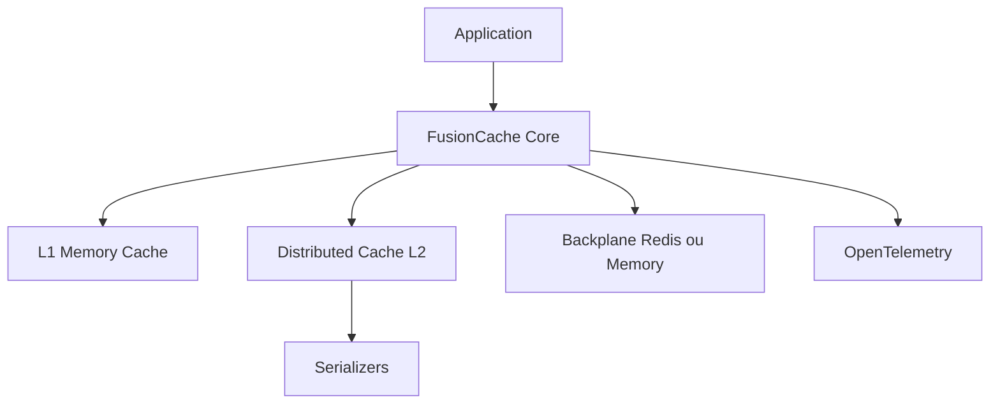

# ZiggyCreatures/FusionCache

> Hybrid .NET cache, memory plus distributed, with protection against request storms, for API developers.

## The problem
A simple memory cache does not survive multi-node scale-up, and a database outage brings the application down.

## What it actually does
An in-memory L1 cache, with an optional L2 via `IDistributedCache`. A backplane (Redis or memory) synchronizes the nodes. It protects against stampedes, reuses an expired entry in case of failure (fail-safe), applies soft and hard timeouts, and refreshes ahead of time. It offers OpenTelemetry, tags and global clearing.

## How it is wired


## Trying it
```bash
PM> Install-Package ZiggyCreatures.FusionCache
```

## Cost and gotchas
Free, MIT license. You need a .NET project; the L2 and the backplane require Redis or equivalent if you enable them. Several complementary packages (serializers, backplane) have to be chosen.

## What it is not
Not a cache for Python nor a database. The production figures in the README (over 100 million downloads) come from the author.

## Alternatives
- Microsoft HybridCache: compatible, FusionCache can be its implementation with extra options.

## For you
Ignore: an excellent cache for a .NET backend, but with no direct use for a data, AI or MLOps profile.
