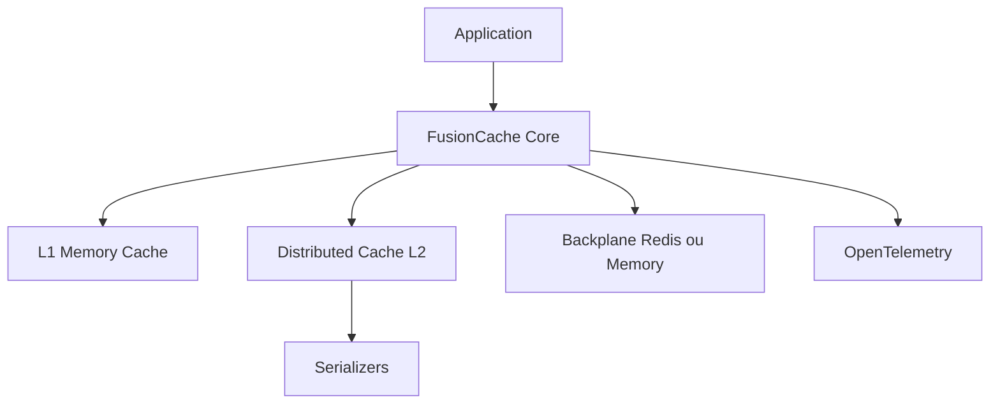

# ZiggyCreatures/FusionCache

> Cache hybride .NET, mémoire plus distribué, avec protection contre les tempêtes de requêtes, pour développeurs d'API.

## Le problème
Un cache mémoire simple ne survit pas à la montée en charge multi-nœuds, et une panne de base fait tomber l'application.

## Ce que ça fait vraiment
Un cache L1 en mémoire, avec L2 optionnel via `IDistributedCache`. Un backplane (Redis ou mémoire) synchronise les nœuds. Il protège contre les tempêtes (stampede), réutilise une entrée expirée en cas de panne (fail-safe), applique des délais souples et durs, et rafraîchit en avance. Il propose OpenTelemetry, étiquettes et nettoyage global.

## Comment c'est branché


## Essayer
```bash
PM> Install-Package ZiggyCreatures.FusionCache
```

## Coût et pièges
Gratuit, licence MIT. Il faut un projet .NET ; le L2 et le backplane demandent un Redis ou équivalent si tu les actives. Plusieurs paquets complémentaires (serialiseurs, backplane) sont à choisir.

## Ce que ce n'est pas
Pas un cache pour Python ni une base de données. Les chiffres de production du README (plus de 100 millions de téléchargements) viennent de l'auteur.

## Alternatives
- Microsoft HybridCache : compatible, FusionCache peut en être l'implémentation avec des options en plus.

## Pour toi
À ignorer : excellent cache pour un backend .NET, mais sans usage direct pour un profil data, IA ou MLOps.

