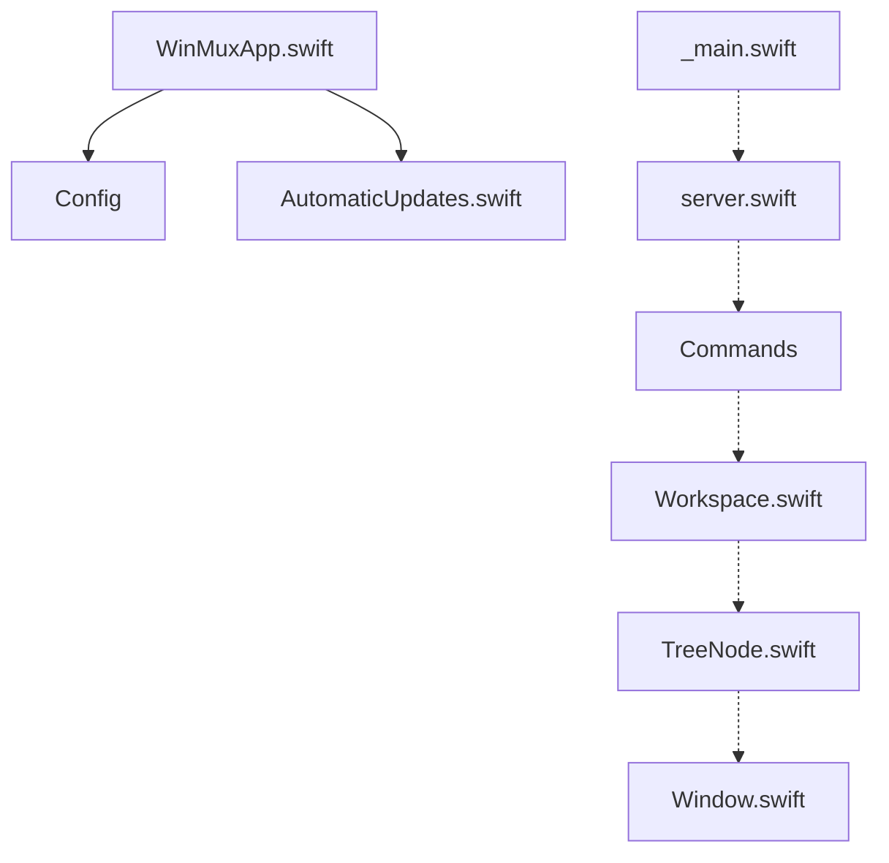

# ZimengXiong/winmux

> Tiling macOS window manager, with projects, workspaces, a sidebar and tab groups.

## The problem
Organizing your macOS windows by project, with tiling and keyboard navigation, goes beyond the default tools.

## What it actually does
WinMux observes windows, sorts them into per-project workspaces and tiles them across multiple monitors. A sidebar replaces Sketchybar-style menu bars; tab groups work like in a browser. Configuration is in TOML, imported from AeroSpace on first launch; a CLI drives a command server.

## How it is wired


## Trying it
```bash
brew tap ZimengXiong/homebrew https://github.com/ZimengXiong/homebrew
brew trust ZimengXiong/homebrew
brew install --cask winmux
xattr -cr /Applications/WinMux.app
```

## Cost and gotchas
Free. macOS required; releases are signed with a developer certificate but not notarized, hence a right-click "Open" at first launch.

## What it is not
Not a cross-platform tool nor one related to data. Empty workspaces are destroyed automatically.

## Alternatives
- AeroSpace: from which WinMux originated and whose configuration it imports.

## For you
Ignore for your line of work; macOS desktop comfort that helps neither data nor MLOps.
