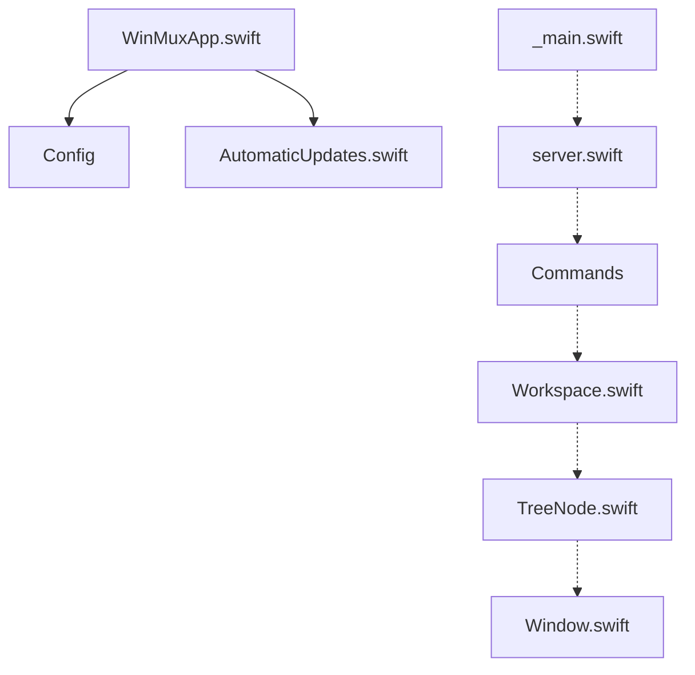

# ZimengXiong/winmux

> Gestionnaire de fenêtres macOS à pavage, avec projets, espaces de travail, barre latérale et groupes d'onglets.

## Le problème
Organiser ses fenêtres macOS par projet, avec pavage et navigation clavier, dépasse les outils par défaut.

## Ce que ça fait vraiment
WinMux observe les fenêtres, les range dans des espaces de travail par projet et les pave sur plusieurs moniteurs. Une barre latérale remplace les barres de menus de type Sketchybar ; les groupes d'onglets fonctionnent comme dans un navigateur. La configuration est en TOML, importée d'AeroSpace au premier lancement ; une CLI pilote un serveur de commandes.

## Comment c'est branché


## Essayer
```bash
brew tap ZimengXiong/homebrew https://github.com/ZimengXiong/homebrew
brew trust ZimengXiong/homebrew
brew install --cask winmux
xattr -cr /Applications/WinMux.app
```

## Coût et pièges
Gratuit. macOS requis ; les versions sont signées avec un certificat de développement mais non notariées, d'où un clic droit « Ouvrir » au premier lancement.

## Ce que ce n'est pas
Ce n'est pas un outil multi-plateforme ni lié à la data. Les espaces de travail vides sont détruits automatiquement.

## Alternatives
- AeroSpace : dont WinMux est issu et dont il importe la configuration.

## Pour toi
À ignorer pour ton métier ; confort de bureau macOS qui n'aide ni les données ni le MLOps.

