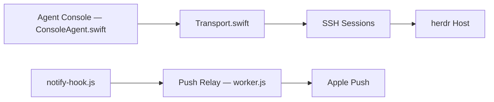

# ZingerLittleBee/Heeler

> iOS app to monitor and control over SSH the coding agents running on your machines under herdr.

## The problem
When a coding agent gets stuck or finishes, you have to go back to your machine to find out and answer it.

## What it actually does
Heeler lists on iPhone/iPad the agents of each machine, sorted by state (blocked first). It opens their real terminal (libghostty rendering), offers a native message editor, a simple shell, SFTP file sending and QR pairing. It talks to herdr's JSON API over SSH, with encrypted notifications and Live Activities via a relay.

## How it is wired


## Trying it
```bash
herdr plugin install ZingerLittleBee/Heeler/plugin --ref main --yes
herdr plugin action invoke heeler.pair
```

## Cost and gotchas
Requires herdr (≥ 0.7.5), Node ≥ 20 and an SSH server with stream-local forwarding. Notifications go through a relay, which cannot read the content according to the README. Available on the App Store, not in every country.

## What it is not
Not an agent nor an official herdr client: the README states it is not affiliated with herdr. Designed first for personal use.

## Alternatives
No alternative named in the README.

## For you
Worth watching: relevant only if you use herdr and long-running agents on a server; otherwise the dependency on this ecosystem weighs too much.
