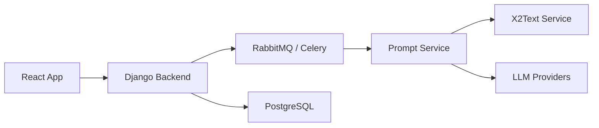

# Zipstack/unstract

> Platform that extracts structured JSON from documents via LLMs, as an API or ETL.

## The problem
Extracting fields from varied invoices or forms requires regexes and per-vendor templates.

## What it actually does
Prompt Studio: define an extraction schema with natural-language prompts.
Deployment as a REST API (document in, JSON out) or as an ETL pipeline (S3, Drive… to Snowflake, BigQuery…).
LLM adapters (OpenAI, Anthropic, Bedrock, Ollama…), vector databases, text extractors (LLMWhisperer, Unstructured).
MCP server and n8n node.

## How it is wired


## Trying it
```bash
git clone https://github.com/Zipstack/unstract.git
cd unstract
./run-platform.sh
```

## Cost and gotchas
It needs at least 8 GB of RAM and an LLM key. Losing `ENCRYPTION_KEY` makes the adapters unusable. PostHog is enabled by default.

## What it is not
Double-LLM verification, human validation and SSO are reserved for the cloud or enterprise offering.

## Alternatives
No alternative is named in the README.

## For you
Worth watching for document extraction in production: complete and self-hostable, but AGPL, heavy, and the reliability features are paid.
