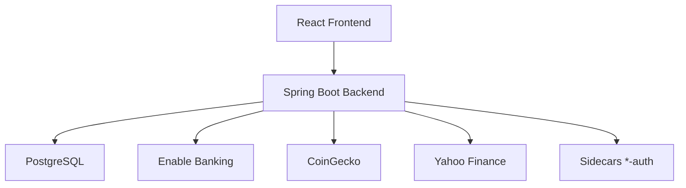

# Zoeille/picsou-finance

> Self-hosted personal finance dashboard, covering banks, stock market, crypto and net worth.

## The problem
Bank accounts, securities, crypto and property are scattered across as many applications, with no unified view of net worth.

## What it actually does
Aggregates accounts, brokers and crypto through Enable Banking, SimpleFIN and per-bank sidecars (Trade Republic, Bourso, Fortuneo, Amundi…). Net worth history, savings goals, multi-profile family, 2FA, GDPR export, Finary import, real estate valuation from open data.

## How it is wired


## Trying it
```bash
git clone https://github.com/Cloeille/picsou-finance.git
cd picsou-finance
docker compose -f docker/docker-compose.yml pull
docker compose -f docker/docker-compose.yml up -d
```
Then open http://localhost:8080 and follow the wizard.

## Cost and gotchas
Free, but HTTPS is required for bank synchronization, and an Enable Banking account. Stores sensitive financial data, with no professional security audit: do not expose it on the Internet. Licence present but not identified by GitHub.

## What it is not
Not an audited product nor an advisory service. Local or home use only. README truncated in the material provided.

## Alternatives
- Finary: import source, commercial service cited.

## For you
Ignore: a personal finance tool unrelated to your work, with an unclear licence and very sensitive data.
