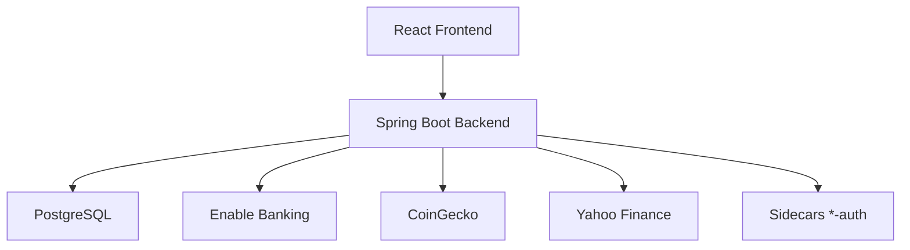

# Zoeille/picsou-finance

> Tableau de bord auto-hébergé de finances personnelles, avec banques, bourse, crypto et patrimoine.

## Le problème
Les comptes bancaires, titres, crypto et biens sont dispersés dans autant d'applications, sans vue de patrimoine unifiée.

## Ce que ça fait vraiment
Agrège comptes, courtiers et crypto via Enable Banking, SimpleFIN et des sidecars par banque (Trade Republic, Bourso, Fortuneo, Amundi…). Historique de patrimoine, objectifs d'épargne, famille multi-profils, 2FA, export RGPD, import Finary, valorisation immobilière en open data.

## Comment c'est branché


## Essayer
```bash
git clone https://github.com/Cloeille/picsou-finance.git
cd picsou-finance
docker compose -f docker/docker-compose.yml pull
docker compose -f docker/docker-compose.yml up -d
```
Puis ouvrir http://localhost:8080 et suivre l'assistant.

## Coût et pièges
Gratuit, mais HTTPS requis pour la synchronisation bancaire, et un compte Enable Banking. Stocke des données financières sensibles, sans audit de sécurité professionnel : ne pas l'exposer sur Internet. Licence présente mais non identifiée par GitHub.

## Ce que ce n'est pas
Pas un produit audité ni un service de conseil. Usage local ou domestique seulement. README tronqué dans la matière fournie.

## Alternatives
- Finary : source d'import, service commercial cité.

## Pour toi
Ignorer : outil de finances personnelles sans lien avec ton métier, et avec une licence floue et des données très sensibles.

