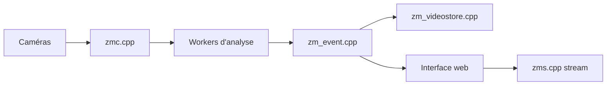

# ZoneMinder/zoneminder

> Linux video surveillance system: capture, analysis, recording and viewing of cameras.

## The problem
Connecting USB or IP cameras and getting event-based recording out of them requires an integrated system.

## What it actually does
Capture processes read the cameras, workers decode and analyze the images, and events are recorded and streamed through a web interface and an API. The code also shows ONVIF and MQTT. Installation via distribution packages is recommended; building from source is discouraged. The Dockerfile has moved to another repository.

## How it is wired


## Trying it
```bash
./utils/zmeditconfigdata.sh ZM_OPT_CAMBOZOLA yes
```
Command intended for package maintainers.

## Cost and gotchas
Free. Documentation is hosted on readthedocs; read the issue-posting rules before opening a ticket.

## What it is not
Not an AI object-detection solution as described in the README: it is capture and recording.

## Alternatives
No alternative named in the README.

## For you
Ignore: video surveillance unrelated to data/AI/MLOps.
