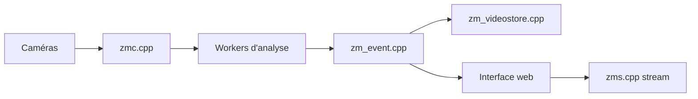

# ZoneMinder/zoneminder

> Système de vidéosurveillance Linux : capture, analyse, enregistrement et visualisation de caméras.

## Le problème
Brancher des caméras USB ou IP et en tirer un enregistrement par événements demande un système intégré.

## Ce que ça fait vraiment
Des processus de capture lisent les caméras, des workers décodent et analysent les images, les événements sont enregistrés et diffusés par une interface web et une API. Le code montre aussi ONVIF et MQTT. Installation recommandée par paquets de distribution ; la compilation depuis les sources est déconseillée. Le Dockerfile a déménagé vers un autre dépôt.

## Comment c'est branché


## Essayer
```bash
./utils/zmeditconfigdata.sh ZM_OPT_CAMBOZOLA yes
```
Commande destinée aux mainteneurs de paquets.

## Coût et pièges
Gratuit. Documentation hébergée sur readthedocs ; règles de publication d'issues à lire avant d'ouvrir un ticket.

## Ce que ce n'est pas
Pas une solution de détection d'objets par IA décrite dans le README : c'est de la capture et de l'enregistrement.

## Alternatives
Aucune alternative nommée dans le README.

## Pour toi
À ignorer : vidéosurveillance sans lien avec data/IA/MLOps.

