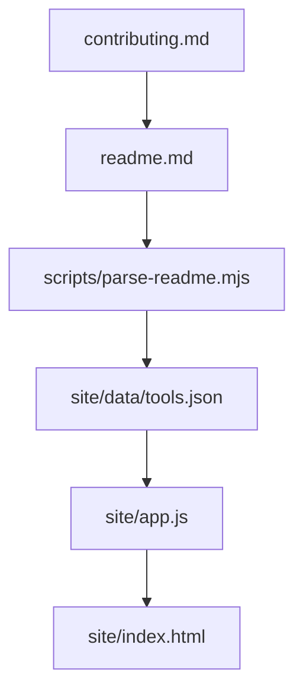

# ZoranPandovski/awesome-testing-tools

> Annotated list of software testing tools: unit, end-to-end, load, mobile, accessibility and observability.

## The problem
Testing tools are numerous and scattered; finding the ones that exist by category takes time.

## What it actually does
A `readme.md` sorts hundreds of links into sections: automated testing, load, mobile, penetration testing, test observability, accessibility, contract testing and QA resources. Many recent entries concern AI agents that test web or mobile interfaces. A script parses the README into `tools.json`, which feeds a static site.

## How it is wired

## Trying it
No command documented: open the `readme.md` or the generated site. The `scripts/parse-readme.mjs` script produces `site/data/tools.json`.

## Cost and gotchas
Free. Entries are described by their authors: some are paid or commercial, and the list guarantees neither quality nor maintenance. The provided README is truncated in the accessibility section.

## What it is not
Not an evaluated comparison: each line reuses the project's own text. It also includes penetration tools, listed without instructions.

## Alternatives
No alternative named in the README.

## For you
Worth watching: a good starting point for spotting agent testing and load testing tools (Locust, k6), to consult occasionally.
