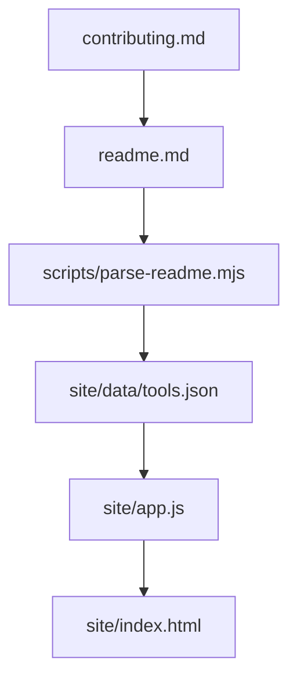

# ZoranPandovski/awesome-testing-tools

> Liste commentée d'outils de test logiciel : unitaires, bout en bout, charge, mobile, accessibilité et observabilité.

## Le problème
Les outils de test sont nombreux et dispersés ; repérer ceux qui existent par catégorie prend du temps.

## Ce que ça fait vraiment
Un `readme.md` classe des centaines de liens en rubriques : tests automatisés, charge, mobile, tests d'intrusion, observabilité des tests, accessibilité, tests de contrat et ressources QA. Beaucoup d'entrées récentes concernent des agents IA qui testent des interfaces web ou mobiles. Un script parse le README en `tools.json` qui alimente un site statique.

## Comment c'est branché

## Essayer
Aucune commande documentée : ouvrir le `readme.md` ou le site généré. Le script `scripts/parse-readme.mjs` produit `site/data/tools.json`.

## Coût et pièges
Gratuit. Les entrées sont décrites par leurs auteurs : certaines sont payantes ou commerciales, la liste ne garantit ni qualité ni maintenance. Le README fourni est tronqué dans la rubrique accessibilité.

## Ce que ce n'est pas
Pas un comparatif évalué : chaque ligne reprend le texte du projet. Elle inclut aussi des outils d'intrusion, listés sans mode d'emploi.

## Alternatives
Aucune alternative nommée dans le README.

## Pour toi
À surveiller : bon point de départ pour repérer des outils de test d'agents et de charge (Locust, k6), à consulter ponctuellement.

