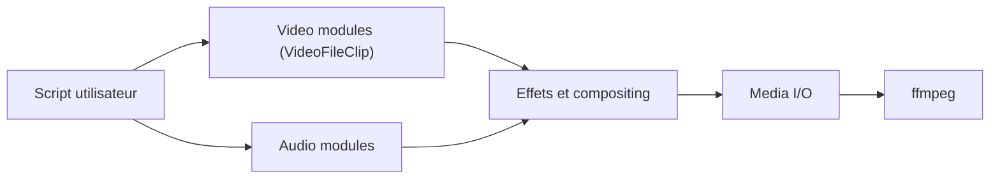

# Zulko/moviepy

> Python library for script-based video editing: cuts, editing, titles, effects, export.

## The problem
Edit or transform videos and GIFs in a reproducible way, without graphical editing software.

## What it actually does
Loads media, converts it into Python objects (NumPy arrays, one pixel = one accessible value) and lets you cut, concatenate, overlay with transparency, add text, apply audio and video effects, then re-encode to mp4, webm or gif. Input/output goes through ffmpeg. The README warns: slower than ffmpeg directly.

## How it is wired


## Trying it
```bash
pip install moviepy
pip install -e .
pip install "moviepy[doc]"
```
The README also provides a Python example (`VideoFileClip(...).subclipped(10, 20)` then `CompositeVideoClip`).

## Cost and gotchas
Free. Version 2.0 brings breaking changes: v1 code must be migrated, and v1 is no longer maintained. Fonts (`TextClip`) and a custom ffmpeg may require configuration.

## What it is not
Not a high-performance video processing engine nor a computer vision tool. For large volumes, ffmpeg alone remains faster.

## Alternatives
The README names only ffmpeg, faster directly but less convenient to script.

## For you
Adopt: handy for preparing clips or video demos in Python (annotation, editing of model results), with active maintainers; do not use it for large-scale processing.
