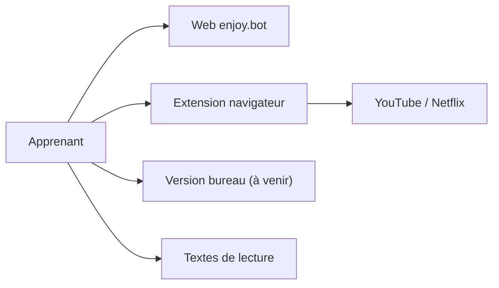

# ZuodaoTech/everyone-can-use-english

> "Enjoy", an AI English-learning assistant, in Chinese, for Chinese-speaking learners.

## The problem
Learning a foreign language without a teacher or guided practice. The README (in Chinese) gives no further detail.

## What it actually does
Minimal entry: the README is under 800 characters. It announces a web version (enjoy.bot), a browser extension for YouTube and Netflix, a desktop version "coming soon", and lists reading resources ("A Thousand Hours", "Everyone can use English"). The internal workings are not documented.

## How it is wired
Not documented; diagram limited to what the README mentions.

## Trying it
No command documented. The README points to https://enjoy.bot and the Chrome Web Store.

## Cost and gotchas
Pricing and account: not documented. The service relies on a site hosted by the authors.

## What it is not
Not a library or a tool to self-host according to the README. No local installation documentation, and the desktop version has not been released.

## Alternatives
None named in the README.

## For you
Ignore: a consumer tool for learning English in Chinese, unrelated to data/AI/MLOps work and with no technical substance in the README.
