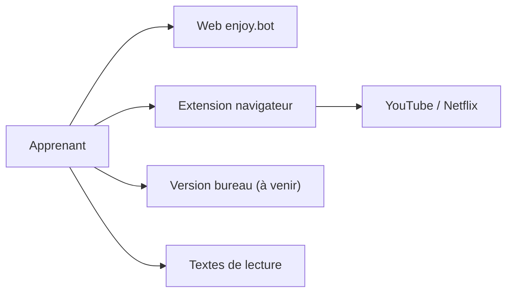

# ZuodaoTech/everyone-can-use-english

> Assistant IA d'apprentissage de l'anglais « Enjoy », en chinois, pour apprenants sinophones.

## Le problème
Apprendre une langue étrangère sans enseignant ni entraînement guidé. Le README (en chinois) ne détaille rien de plus.

## Ce que ça fait vraiment
Fiche minimale : le README fait moins de 800 caractères. Il annonce une version web (enjoy.bot), une extension navigateur pour YouTube et Netflix, une version bureau « bientôt publiée », et liste des ressources de lecture (« Mille heures », « Everyone can use English »). Le fonctionnement interne n'est pas documenté.

## Comment c'est branché
Non documenté ; schéma limité à ce que le README cite.

## Essayer
Aucune commande documentée. Le README renvoie vers https://enjoy.bot et le Chrome Web Store.

## Coût et pièges
Tarification et compte : non documentés. Le service repose sur un site hébergé par les auteurs.

## Ce que ce n'est pas
Pas une bibliothèque ni un outil à auto-héberger d'après le README. Pas de documentation d'installation locale, la version bureau n'est pas sortie.

## Alternatives
Aucune nommée dans le README.

## Pour toi
Ignorer : outil grand public d'apprentissage de l'anglais en chinois, sans lien avec un travail data/IA/MLOps et sans matière technique dans le README.

