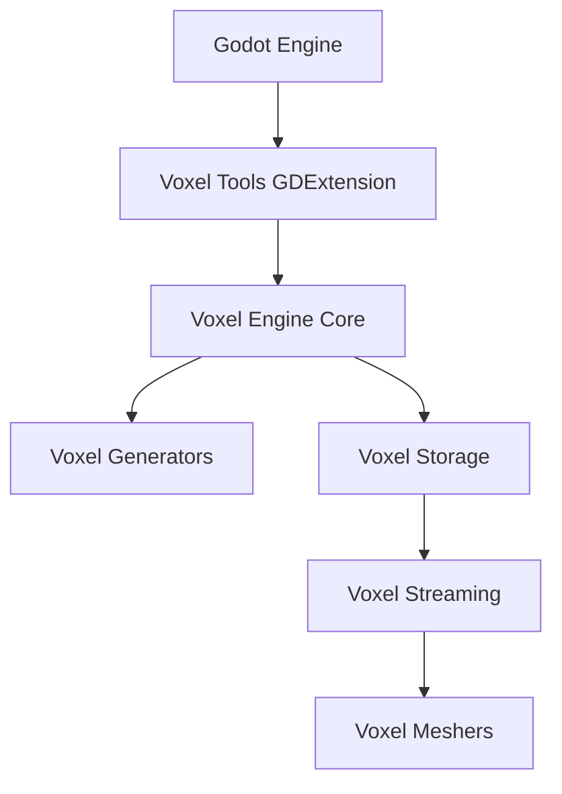

# Zylann/godot_voxel

> C++ module for Godot 4 that creates volumetric terrains editable in real time.

## The problem
A heightmap terrain allows neither overhangs, nor tunnels, nor destruction by the player.

## What it actually does
The module stores voxels in blocks, turns them into meshes (blocky style or smooth with Transvoxel and levels of detail), handles Godot physics, infinite terrains through paging, generators (simple, graph-based, multipass), data streams (including SQLite) and an instancing system for vegetation. It also includes editor tools.

## How it is wired


## Trying it
```bash
# Aucune commande dans le README : il renvoie à la documentation d'installation et de démarrage rapide.
```

## Cost and gotchas
Free. Godot 4 is required and, depending on the method, compiling the module. The README roadmap still cites "make GDExtension work": the state of that route needs checking. Volunteer project.

## What it is not
It is not a game nor a turnkey world editor. Multiplayer synchronization is still a roadmap idea.

## Alternatives
No alternative named in the README.

## For you
Ignore: a game-development tool unrelated to data or AI.
