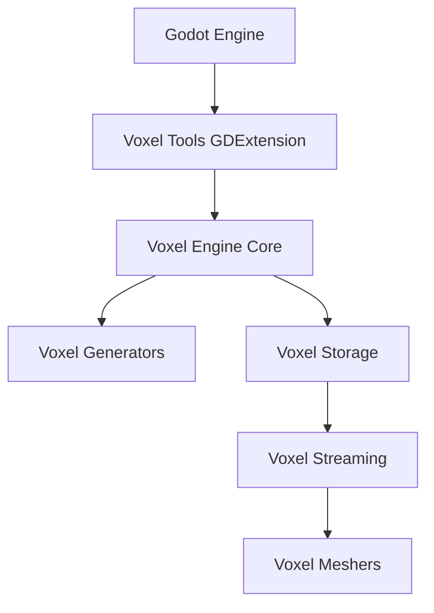

# Zylann/godot_voxel

> Module C++ pour Godot 4 qui crée des terrains volumétriques modifiables en temps réel.

## Le problème
Un terrain par carte de hauteurs ne permet ni surplombs, ni tunnels, ni destruction par le joueur.

## Ce que ça fait vraiment
Le module stocke des voxels par blocs, les transforme en maillages (style cubique ou lisse avec Transvoxel et niveaux de détail), gère la physique Godot, des terrains infinis par pagination, des générateurs (simples, par graphe, multipasses), des flux de données (dont SQLite) et un système d'instances pour la végétation. Il comprend aussi des outils d'éditeur.

## Comment c'est branché


## Essayer
```bash
# Aucune commande dans le README : il renvoie à la documentation d'installation et de démarrage rapide.
```

## Coût et pièges
Gratuit. Il faut Godot 4 et, selon la méthode, compiler le module. La feuille de route du README cite encore « faire fonctionner GDExtension » : l'état de cette voie est à vérifier. Projet bénévole.

## Ce que ce n'est pas
Ce n'est pas un jeu ni un éditeur de monde clé en main. La synchronisation multijoueur est encore une piste de feuille de route.

## Alternatives
Aucune alternative nommée dans le README.

## Pour toi
À ignorer : outil de développement de jeu sans rapport avec la data ou l'IA.

