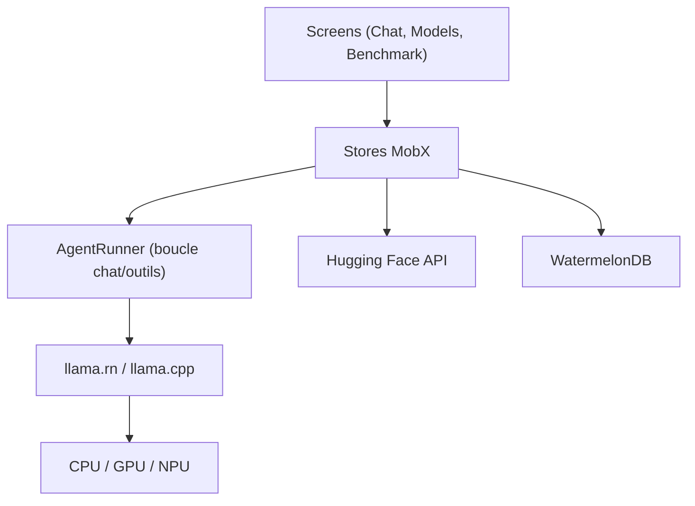

# a-ghorbani/pocketpal-ai

> Private AI assistant that runs GGUF models directly on a phone, offline.

## The problem
AI apps send every message to a third-party server, and do not work without a connection.

## What it actually does
React Native application (iOS, Android) that loads GGUF models via llama.rn (llama.cpp), with Whisper dictation, local neural voices, Pals (personas), callable tools (calculation, date, optional web search) and model search on Hugging Face. Tokens/s and memory benchmark. CPU, GPU and Qualcomm NPU acceleration.

## How it is wired


## Trying it
```bash
git clone https://github.com/a-ghorbani/pocketpal-ai
cd pocketpal-ai
nvm use
yarn install
(cd ios && pod install)
yarn start
yarn ios
yarn android
```

## Cost and gotchas
Free; optional PocketPal Plus purchase in the stores (hands-free voice, included in source builds). Phone disk space and RAM limit the models. Build: Node 22.21.0, Yarn 1, Xcode 26.6 for iOS.

## What it is not
Not a model host nor a training tool. Privacy only holds if you do not enable web search or a remote server.

## Alternatives
No alternative named in the README.

## For you
Keep an eye on it: a good testbed for measuring small quantized models on mobile, and an architecture reference for llama.rn.
