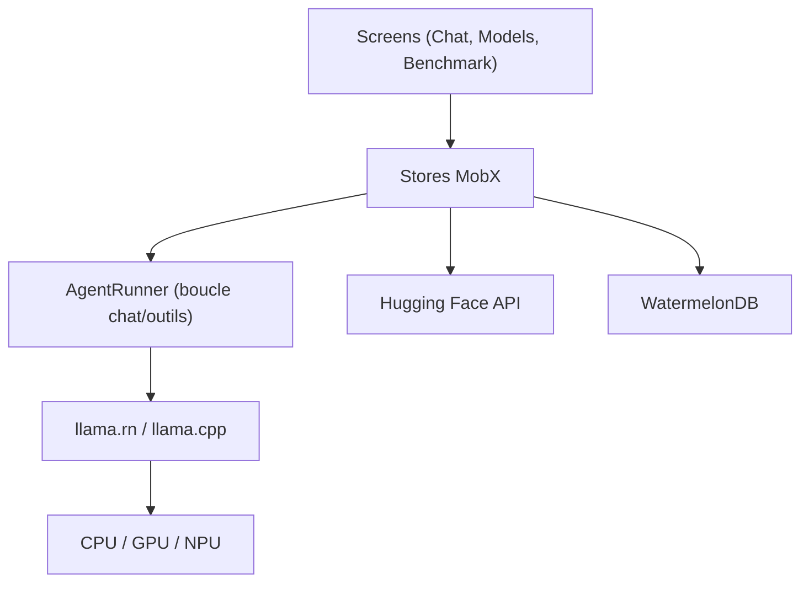

# a-ghorbani/pocketpal-ai

> Assistant IA privé qui fait tourner des modèles GGUF directement sur téléphone, hors ligne.

## Le problème
Les applis d'IA envoient chaque message à un serveur tiers, et ne marchent pas sans connexion.

## Ce que ça fait vraiment
Application React Native (iOS, Android) qui charge des modèles GGUF via llama.rn (llama.cpp), avec dictée Whisper, voix neuronales locales, Pals (personas), outils appelables (calcul, date, recherche web optionnelle) et recherche de modèles sur Hugging Face. Benchmark tokens/s et mémoire. Accélération CPU, GPU et NPU Qualcomm.

## Comment c'est branché


## Essayer
```bash
git clone https://github.com/a-ghorbani/pocketpal-ai
cd pocketpal-ai
nvm use
yarn install
(cd ios && pod install)
yarn start
yarn ios
yarn android
```

## Coût et pièges
Gratuit ; achat optionnel PocketPal Plus dans les stores (voix mains libres, inclus en build source). Espace disque et RAM du téléphone limitent les modèles. Build : Node 22.21.0, Yarn 1, Xcode 26.6 pour iOS.

## Ce que ce n'est pas
Pas un hébergeur de modèles ni un outil d'entraînement. La confidentialité n'est valable que si tu n'actives pas la recherche web ou un serveur distant.

## Alternatives
Aucune alternative nommée dans le README.

## Pour toi
Surveiller : bon banc d'essai pour mesurer des petits modèles quantifiés sur mobile, et référence d'architecture llama.rn.

