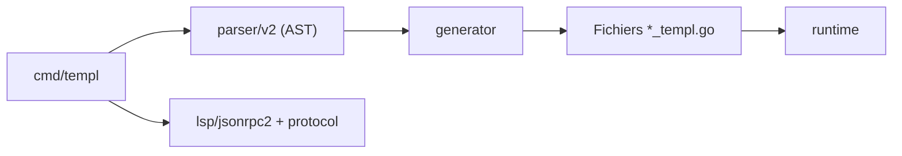

# a-h/templ

> HTML templating language for Go, with a compiler, a formatter and an LSP server for the editor.

## The problem
The HTML templates of the Go standard library are weakly typed and poorly supported in the editor.

## What it actually does
The README contains only development tasks and a link to `templ.guide`. From the code: the `templ generate` command reads `.templ` files, parses them (`parser/v2`), produces Go (`*_templ.go`) through a generator, and the generated code relies on a runtime. `templ fmt` formats, `templ lsp` serves the editor.

## How it is wired


## Trying it
```bash
go run ./cmd/templ generate -include-version=false
go test ./...
go run ./cmd/templ fmt .
```

## Cost and gotchas
Free. The README describes contribution tasks (version, build, tests, fuzz, docs) rather than a user installation: all usage lives in the external documentation.

## What it is not
Not a full UI library: it is a compiler that produces Go. The README is nearly empty on the user side, so little can be verified here.

## Alternatives
No alternative named in the README.

## For you
Ignore: an HTML rendering tool for Go, of no interest for a data/AI/MLOps profile; the README provides almost no material here.
