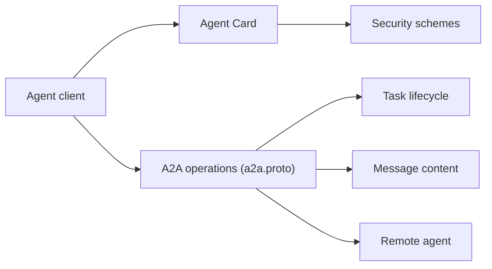

# a2aproject/A2A

> Open protocol for AI agents from different frameworks to discover each other and collaborate.

## The problem
Agents built on different frameworks and by different vendors share no common language to cooperate.

## What it actually does
Specifies JSON-RPC 2.0 over HTTP(S), discovery via "Agent Cards", synchronous exchanges, streaming (SSE) or push notifications, and the transfer of text, files and structured JSON. Agents remain opaque (no sharing of internal state). This repository holds the specification; SDKs exist in Python, Go, JS, Java, .NET and Rust.

## How it is wired


## Trying it
```bash
pip install a2a-sdk
go get github.com/a2aproject/a2a-go
npm install @a2a-js/sdk
```

## Cost and gotchas
Free. The agents behind it may cost API keys. The README lists upcoming changes (authorization in the AgentCard, etc.): the specification is still moving.

## What it is not
Not a server nor an agent framework: a protocol. It complements MCP (agents among themselves), without replacing it.

## Alternatives
- MCP: tools for a single agent, according to the cited course (A2A complements MCP).

## For you
Worth following if you orchestrate several heterogeneous agents; under the Linux Foundation, so relatively neutral.
